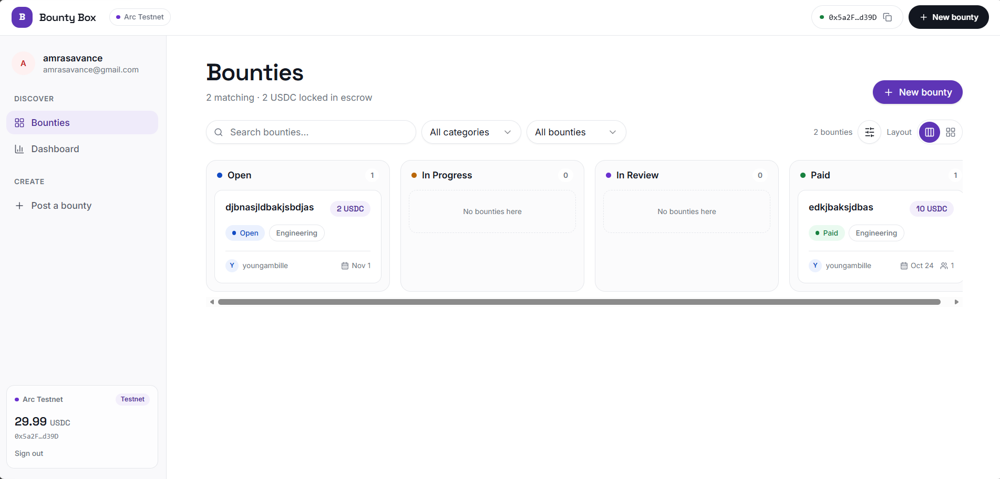
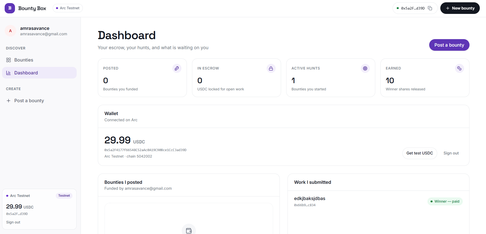

# BountyBox — USDC micro-task bounties on Arc

Built for **Arc Microgrants**: Arc mainnet is live

BountyBox is one such experiment: a USDC-powered micro-task bounty platform
where the smart contract holds the money, enforces the rules, and records the
value-bearing lifecycle events, and the database holds the content. Not
everything starts as a startup. See
[docs/ARCHITECTURE.md](docs/ARCHITECTURE.md) for the onchain/offchain split

Arc uses USDC to pay gas, so you need a small amount of USDC on Arc to deploy
and transact. No traction, company, deck, or roadmap needed — just something
real that runs.

## Deployed addresses

| Network | Chain id | BountyBoard | Explorer |
| --- | --- | --- | --- |
| Arc mainnet | 5042 | `0x57bC93735d190c24c0215DB48f52DEc796770e21` | [ArcScan](https://explorer.arc.io/address/0x57bC93735d190c24c0215DB48f52DEc796770e21) |
| Arc testnet | 5042002 | `0xDc553dF938B2ad9d846784dCbc583a5c9f5F0d22` | [ArcScan](https://explorer.testnet.arc.io/address/0xDc553dF938B2ad9d846784dCbc583a5c9f5F0d22) |

[BountyBox — USDC micro-task bounties on Arc](https://bountybox-brown.vercel.app/) 

Rewards on both networks use Arc's USDC ERC-20 interface at
`0x3600000000000000000000000000000000000000` (6 decimals, verified
`symbol() == USDC` on mainnet). Arc is USDC-native: USDC is also the gas token
(18-decimal native view). Never mix the two views; always read `decimals()`.

## Contract

`contracts/BountyBoard.sol` escrows USDC for open, many-worker bounties that pay
up to `maxWinners` workers a flat `rewardPerWinner` (a classic single-winner
bounty is just `maxWinners = 1`). Workers press "working on it" (recorded
onchain), the creator accepts workers one at a time, and a permissionless safety
valve guarantees refunds of any unspent prize pool.

```
createBounty ──► Open ──startWorking──► (workers register onchain)
                 │ │
   cancelBounty  │ │   (creator, only while workerCount == 0) ──► Cancelled (refund all)
                 │ ├─approveWork(worker, ref) ──► pays rewardPerWinner  (repeatable)
                 │ │     └── winnerCount == maxWinners ──► Completed
                 │ └─finalizeBounty ──► Completed (refund unspent pool)
                 └─expireBounty ──► Expired (refund unspent; permissionless)
                    · abandoned: nobody working, app deadline passed
                    · creator silent: submissionDeadline + reviewPeriod passed
```

- Creator: `createBounty`, `approveWork(id, worker, ref)`, `finalizeBounty`, `cancelBounty`.
- Worker: `startWorking(id)` — the UI's "working on it" button (capped by per-bounty `maxWorkers`).
- Anyone: `expireBounty(id)` (unspent escrow always returns to the creator, after the per-bounty `reviewPeriod`); `rescueSurplus(to, amount)` (recovers stray USDC sent outside `createBounty`, escrow never touchable).
- Views: `getBounty`, `getWorkers`, `getWinners`, `isWorking`, `isWinner`,
  `remainingReward`, `isFunded`, `surplus`, `totalEscrowed`.

Once someone is working the creator can no longer withdraw the pool — the only
ways to move money are accepting workers or finalizing. See
[docs/ARCHITECTURE.md](docs/ARCHITECTURE.md#worker-incentives-read-this-before-shipping)
for the worker-incentive tradeoffs.

Run the tests:

```shell
npx hardhat test            # Solidity unit tests + TypeScript integration tests
npx hardhat test solidity   # contracts/*.t.sol only
npx hardhat test nodejs     # test/*.ts only
```

## Deploy

```shell
# local simulated chain (deploys a 6-decimal MockUSDC too; no secrets needed)
npm run deploy:local

# Arc testnet (.env: ARC_TESTNET_RPC_URL + ARC_PRIVATE_KEY)
echo "y" | npm run deploy:testnet

# Arc mainnet, chain 5042 (.env: ARC_MAINNET_RPC_URL + funded ARC_PRIVATE_KEY).
# Uses the optimized production build; Ignition asks for confirmation.
echo "y" | npm run deploy:mainnet
```

The frontend selects its chain with `VITE_ARC_NETWORK` (`testnet` default,
`mainnet` for the live board) and the contract with
`VITE_BOUNTYBOARD_ADDRESS` — both are runtime env vars, no rebuild needed.

## Frontend

Vite + React app (`frontend/`: TanStack Query, react-router, Privy auth,
viem). Identity is Privy (email/social/wallet, embedded wallet on Arc); the
contract is the source of truth for money and lifecycle — the UI reads
`getBounty`/`getWorkers`/`getWinners` directly and layers them over Supabase
content rows. No indexer.

**Live app:** [bountybox-brown.vercel.app](https://bountybox-brown.vercel.app/)



- **Bounties board** — kanban by live escrow state (Open / In Progress / In
  Review / Paid), search, category filters, escrow totals. The navbar wallet
  chip shows the connected address with one-click copy.
- **Dashboard** — posted bounties, escrow locked, active hunts, earned shares,
  wallet balance with faucet shortcut (testnet), and the full submission
  history including paid winners.



- **Post a bounty** — two-step flow (details → fund escrow): reward, winner
  slots, worker cap, review window, deadlines; USDC approval + `createBounty`
  in one guided transaction.
- **Bounty detail** — escrow panel, workers, submissions with accept/reject,
  lifecycle timeline, comments; creator actions (accept, finalize, withdraw,
  expire) call the contract and refresh the DB display cache.

Run it:

```shell
cd frontend && npm install && npm run dev   # .env: VITE_* keys (see env usage in src/lib/env.js)
npm run build                               # production bundle (ships as nginx container)
```

Rewards use Arc's USDC ERC-20 interface at `0x3600000000000000000000000000000000000000`
(6 decimals). Arc is USDC-native: USDC is also the gas token (18-decimal native
view). Never mix the two views; always read `decimals()`.


